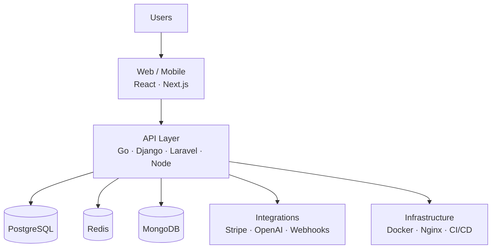

<h1 align="center">Raj Gupta</h1>

  <b>Founder · Software Architect</b> 
  I design, build and ship B2B SaaS products end to end.

  
  

---

I build software businesses, not just software. My work sits across the whole
lifecycle — product design, architecture, implementation, infrastructure and
growth — with a focus on **B2B SaaS, compliance automation, AI-powered tooling
and developer products**.

Currently running several products in parallel, most of them multi-tenant,
subscription-based and API-first.

---

## Products

| Product | What it does | Status |
| --- | --- | --- |
| **BearingTrust** | AML, KYB, company intelligence and ongoing compliance monitoring | Live |
| **ZunoForm** | Modern form builder and data collection platform | Live |
| **Atrail** | Interactive product tours and user onboarding | Live |
| **ThreadHive** | AI-powered customer support and sales agent platform | Live |
| **EngagePop** | Popups, web push and customer engagement | Live |
| **Zintara** | Cold outreach and email automation infrastructure | Beta |

---

## Stack

**Languages** — Go · Python · TypeScript · PHP · JavaScript

**Backend** — Django · Laravel · Node.js · Flask

**Frontend** — React · Next.js · Tailwind CSS

**Data** — PostgreSQL · MySQL · MongoDB · Redis · SQLite

**Infrastructure** — Docker · Linux · Nginx · GitHub Actions · CI/CD

**Platforms & APIs** — Stripe · OpenAI · Claude · REST · Webhooks · OAuth · JWT

---

## How I build

Multi-tenant by default, background jobs over cron where it matters, webhooks
verified and idempotent, and infrastructure that can be rebuilt from a repo.

---

## Focus areas

| Area | What I'm working on |
| --- | --- |
| **AI** | Agents, automation and intelligent workflows inside real products |
| **SaaS** | Multi-tenant architecture, billing, subscriptions, usage metering |
| **Compliance** | AML, KYB, sanctions screening and continuous monitoring |
| **Infrastructure** | APIs, containers, deployment pipelines, self-hosted systems |
| **Growth** | SEO-led acquisition and product-led growth |

---

## Contact

Open to conversations about compliance tooling, SaaS architecture and
interesting product problems.

**Email** — [rajguptaindia01@gmail.com](mailto:rajguptaindia01@gmail.com)
**GitHub** — [@rajgupttaa](https://github.com/rajgupttaa)
